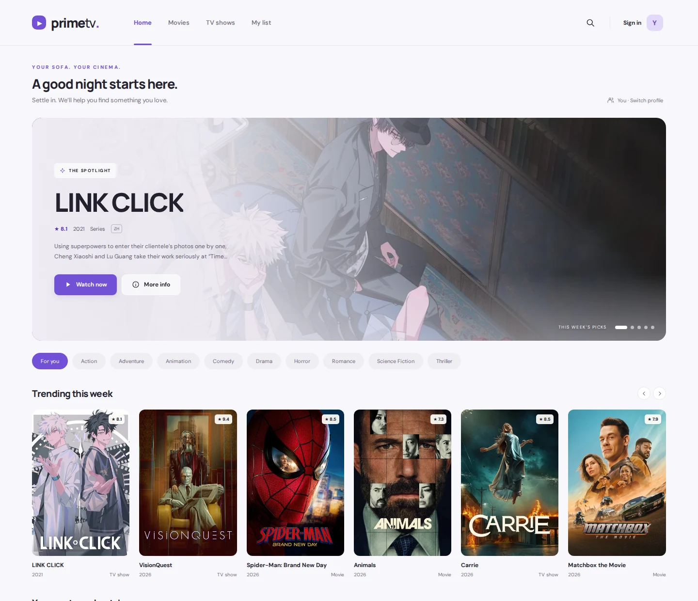

<div align="center">

# PrimeTV

A quieter place to find your next favorite.



</div>

A light, purple movie and TV interface built with HTML, CSS, and JavaScript. Static hosting works on GitHub Pages; Supabase handles accounts and synced profiles once connected.

### The experience

- Responsive browsing with a cinematic spotlight, movie rows, genre filters, search, and title details.
- Up to five profiles with their own watch history, likes, dislikes, and watchlists.
- Continue Watching with actual player timestamps and episode selection. Resume uses CineSrc's player messaging interface; native video is also supported.
- Personalized picks combine explicit likes/dislikes, watch completion, recency, genre/language preferences, TMDB related-title candidates, Bayesian quality scores, and diversity reranking. Reasons are shown beneath recommendations. This is a content-based recommender, not a trained collaborative model.
- Email signup, signin, confirmation, password reset, and signout through Supabase Auth.
- Row-level database permissions restrict profiles and history to their account owner.

### Open the website

Use **[PrimeTV on GitHub Pages](https://itsmecodyy.github.io/PrimeTV/)**. GitHub hosts the site; you do not need to run a server or leave your Mac on.

### Optional local development

The following commands are only for developers editing the site locally:

```sh
npm ci
npm run dev
```

Open `http://127.0.0.1:4173`. ES modules need an HTTP server; opening `index.html` as a file will not work.

The root files can be served directly by GitHub Pages. The pinned Supabase browser bundle is committed in `vendor/`. `npm run build` regenerates it and creates an optional `dist/` directory for other static hosts.

### Connect the movie catalog

Set `tmdbKey` in `config.js` to the TMDB browser API key you authorize for this site. It is intentionally blank in this draft because publication of the existing key requires explicit approval. The catalog will not load until this is configured.

### Connect accounts

**A live account backend has not been configured in this branch.** Guest profiles work locally. Signup is visibly unavailable until both public Supabase settings are filled in.

1. Choose the Supabase project for PrimeTV. The implementation does not provision one or modify an unrelated project.
2. Run [`database/setup.sql`](./database/setup.sql) once in that project's SQL editor. It creates only the `primetv_profiles` and `primetv_activity` tables and their ownership policies.
3. Add the project URL and **publishable** key to `config.js`. Never use a secret or service-role key in browser code.
4. Enable email/password authentication. Set the Auth Site URL to the live PrimeTV URL and add that URL to the redirect allowlist, including its trailing `/`. For the current GitHub Pages path this is `https://itsmecodyy.github.io/PrimeTV/`. Add `http://127.0.0.1:4173/` for local testing if needed.
5. Configure an SMTP provider for public signup and password-reset delivery. Supabase's default email sender has development restrictions; test confirmation and recovery with a non-team email before launch.
6. Verify signup, email confirmation, signin, a second-device resume, signout, and password recovery against the chosen project.

Until these steps are complete, no claim is made that live accounts or cross-device syncing are active. The account flow is integration-tested against a simulated Supabase API; the SQL policies are tested using a local Postgres-compatible engine.

### Playback and saved data

CineSrc remains the existing external playback provider. Messages are accepted only from the active iframe at the exact configured origin. `timeupdate`, `seeked`, `pause`, and `ended` events update progress; `seek` restores a saved timestamp. Provider availability, source playback, and delivery of player events remain outside PrimeTV's control. Automatic episode advancement inside the embed is disabled so the app can keep episode identity correct. The Next episode button updates the app's saved season/episode.

For video you host or are authorized to serve, map `movie:ID` or `tv:ID:SEASON:EPISODE` to an HTTPS URL in `config.media`. The native video player uses media events for progress and resume.

Progress is checkpointed every ten seconds, on pause, on player close, and when the page becomes hidden. Abrupt termination can lose the newest checkpoint. Failed cloud writes stay in a queue scoped to the account and profile; reconnecting or choosing Sync retries them. Simultaneous changes to the same title use last-write-wins. Signout waits for pending changes and clears that account's cached library data.

Existing legacy favorites and recently started titles migrate into a guest profile once. The old fabricated progress percentage is deliberately not imported. Guest history stays separate from account history. Profiles within one account are conveniences, not PIN-protected security boundaries.

### Verify

```sh
npm test
npx playwright install chromium
npm run test:e2e
npm run build
```

Tests cover ranking, trusted playback events, cross-account database isolation, profile limits, browsing, mobile overflow, reload-and-resume, separate profiles, episode selection, and mocked account sync/restoration. Browser tests use fixtures and do not create real accounts or stream real titles.

### Credits

Movie and TV metadata/artwork are provided by TMDB. This product uses the TMDB API but is not endorsed or certified by TMDB. Third-party package notices are in `vendor/THIRD_PARTY_LICENSES.txt`.
